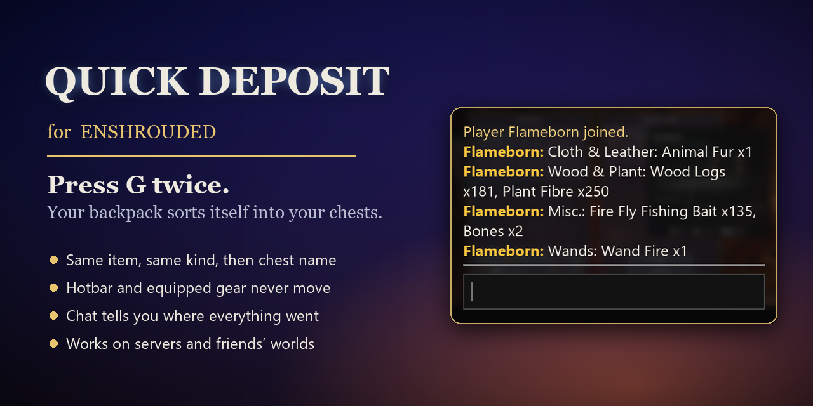
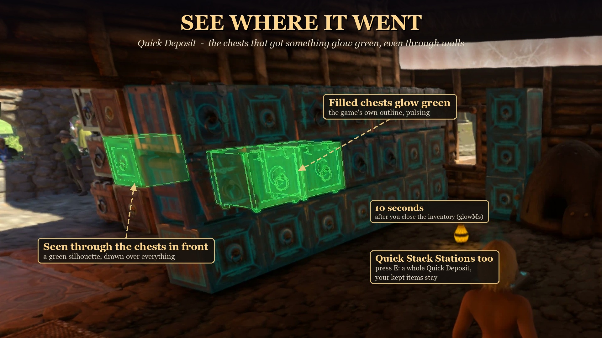

# Quick Deposit for Enshrouded

Open your inventory inside your base and press **G twice**. Everything in your backpack goes
into the chest where it belongs, and your chat tells you where it went. One G is still the
game's own Sort Inventory.

Nothing to configure, works on dedicated servers and friends' worlds. Only you
need it installed.

## Where things go

1. **Same item** - every chest in the base gets the chest window's own "Deposit Stacks":
   stacks of items a chest already holds are topped up there.
2. **Everything else**, stack by stack, into a free slot of:
   1. a chest that holds the same item (when several do, the one holding the most of it; its
      partial stacks of it are filled first),
   2. else the chest whose items fit it best: food and potions of the same sort first, then
      items whose names share a word with it, then a chest named for it, then the most different
      items of the same kind (category; weapons: same weapon
      type; ammo: same ammo type or the weapons that fire it, e.g. arrows with bows;
      armor: where it is worn, helmets with helmets, boots with boots; shields and wards
      together; rings with rings),
   3. else the chest whose name matches the item, in your game's language: the item's own name,
      then for gear its type as the tooltip shows it ("Head Armor", "Shield"), then
      "Equippable", then single words ("Wands" for a wand, "Bows & Arrows" for arrows). A chest
      named for another type ("Foot Armor") never gets a helmet,
   4. else, for weapons, the chest holding the most weapons,
   5. else the chest nearest to you. Not gear (armor, shields, rings, backpacks): with no chest
      for its kind it stays in your backpack.

Your chat then shows where everything went, using your chest names ("Wands: Wand Epic Fire
x1"; unnamed chests are called after what they mostly hold), and `quick-deposit-report.txt`
in `greeneye\quick-deposit\` has the full report. Those chat lines exist only on your screen and
look like the game's own notices; nothing is sent to other players. `chat=short` in the ini trims
them to one line per deposit ("stored 230 items in 4 chests"), `chat=off` turns them off.

Every move is a normal transfer that the host checks and performs, exactly as if you had
dragged the item yourself. The host takes about one transfer per network tick, so they go out
one every `delayMs`; whatever the host didn't take (a dropped command, a full chest) gets another
try in a few retry passes.

The chests that got something glow green (the game's own outline, pulsing, and a silhouette
that shows through walls) while your inventory stays open and for `glowMs` (10 s) after you close
it, so you see where things went.

In a world your game hosts, step 1 happens at once for the whole base, the way a Quick Stack
Station deposits around it (chests with "Receive Quick Stacking" off are left out); the
stack-by-stack moves follow for the rest.

## Keeping items in your backpack

Hover a stack in your inventory and press **K**. Kept stacks get a teal border.

- **Items that stack** (Torches, Arrows, Straw): K keeps every one of the item. All its stacks
  in your backpack are marked, and new ones you pick up arrive marked.
- **K on a marked stack** frees just that stack: the next deposit takes it, the item stays
  kept. K on the last marked stack ends the mark. To keep only part of a stack, split it
  (Ctrl + mouse) and free the part that may go.
- **Gear** (anything that doesn't stack) is marked piece by piece. Its mark ends when it leaves
  you: sold, salvaged or put into a chest. Gear in your grave after a death stays marked.

The kept amount survives sorting: when G merges your stacks, a deposit splits off just the
rest. Kept stacks also hold their slots: right after G sorts your backpack they move back to where
they were, so an order of spells or arrows stays, and everything else stays sorted. Your chat ends with what stayed ("Kept (marked): Straw x50"). The hint bar at the bottom
shows **K Keep in Backpack** and **G Twice: Quick Deposit**.

Each of your characters has its own marks, the same in every world: Quick Deposit knows which
character you play as soon as you enter a world. Marks are saved in `quick-deposit.ini`, a `[Keep.<character id>]` section per character
(`keepItems=Torch,Pikemead's Bulwark #803635338 x1`; a name without an amount keeps every one;
gear is saved with its item id, as tiers can share a name). Freed
stacks are kept again after a restart.

**Quick Stack Stations** run a whole Quick Deposit instead of their own, exactly like G twice:
the whole base, sorting, the chat report, kept items stay. This works everywhere, the host does not
need Quick Deposit:

- In a world your game hosts (solo or with friends joining you), the host part takes the station
  over and deposits at once.
- On a dedicated server or a friend's world, your Quick Deposit keeps the station's own request
  from reaching the host and runs its deposit from your side, chest by chest.

The chests a station fills glow green too.

## What is never moved

- Your hotbar (both rows), equipped gear, cosmetics and currency.
- What you marked with K.
- Categories left out of `tier2Categories` (default: none - everything in the backpack grid
  is sorted; your hotbar is what you keep).
- With `newItems=stay`: items no chest holds yet.
- Crafting stations: only storage chests are used.
- Chests whose name starts with `--` (rename one in game, e.g. "--My Stuff"), and chests
  listed in `excludeChests`: they get nothing, not even "Deposit Stacks" top-ups.

 

## Install

1. Close Enshrouded.
2. Download `QuickDeposit-1.3.23.zip` from [Releases](../../releases/latest) or
   [Nexus Mods](https://www.nexusmods.com/enshrouded/mods/195).
3. In Steam: right-click Enshrouded > Manage > Browse local files.
4. Copy everything from the zip into that folder, keeping the folders: `dbgcore.dll` (the
   Greeneye Loader) next to `enshrouded.exe`, and `greeneye\quick-deposit\`.
5. Start the game.

Updating from 1.1 or older: delete `powrprof.dll`; your `quick-deposit.ini` moves to
`greeneye\quick-deposit\` on the first start. The same DLL still works on its own when renamed
to `powrprof.dll` and put next to `enshrouded.exe`, without the loader.

Works next to EML, Shroudtopia, Auto Loot Plus and Creative Mode. Uninstall: delete
`greeneye\quick-deposit\`, and `dbgcore.dll` with the `greeneye` folder if no other Greeneye
mod is left.

## Settings (`quick-deposit.ini`)

Created on first start in `greeneye\quick-deposit\` (the game folder without the loader);
edit it while the game is closed.

| Key | Default | Meaning |
|---|---|---|
| `enabled` | `1` | `0` turns the mod off |
| `doubleSortMs` | `500` | how quickly the second G must follow; `0` turns double-G off |
| `hotkey` | (none) | optional extra key: a letter, digit, `F1`-`F24`, `Mouse4`..., with `Shift+`, `Ctrl+`, `Alt+`, or a code such as `0x76`; a controller button after a comma: `F6, Pad:LB+A` |
| `delayMs` | `100` | pause between chest commands (the host takes about one per network tick); each retry pass also waits this much longer than the last. Raise it if chests get skipped on a laggy server |
| `settleMs` | `1500` | the longest wait for the server's changes before the next step and the report (it moves on as soon as your backpack stops changing) |
| `tier2` | `on` | `on`, `dry` (only report the plan) or `off` (only "Deposit Stacks") |
| `excludeChests` | (none) | chest names to skip, comma-separated (besides names starting with `--`) |
| `tier2Categories` | `all` | what step 2 may move: `all` or a list such as `Materials,Weapons` |
| `tier2Order` | `item,kind,name,weapons,nearest` | how step 2 picks a chest, first match wins: `item` (holds the same item), `kind` (holds items of the same kind: same food or potion sort first, then a shared name word, a matching chest name, the most such items), `name` (its name matches the item), `weapons` (holds the most weapons; weapons only), `nearest`. Leave a rule out to skip it; a stack no rule places stays in the backpack. `name,item,kind,weapons,nearest` puts chest names first |
| `newItems` | `sort` | `stay` leaves items no chest holds yet in the backpack |
| `chat` | `full` | the deposit report in your chat: `full` (every chest and what stayed), `short` (one summary line) or `off`; the report file always has everything |
| `glowMs` | `10000` | how long the chests a deposit filled glow green after you close the inventory; `0` turns it off |
| `keepKey` | `K, Pad:LS` | over a stack in your inventory: keep it in the backpack; same format as `hotkey`; on a controller it marks the selected slot; empty turns it off |
| `keepItems` | (none) | what K marked, e.g. `Straw x50,Torch` (no amount: every one); one list per character, under `[Keep.<character id>]` |
| `language` | `auto` | the language of the key hints and chat lines (the report file stays English): `auto` follows the game, or `english`, `german`, `french`, `italian`, `spanish`, `brazilian`, `polish`, `russian`, `ukrainian`, `turkish`, `japanese`, `koreana`, `schinese`, `tchinese`, `thai` |

## Limits

- Only inside a base (flame altar area); the host decides whether you may deposit there.
- The in-game "area deposit" toggle of a chest is not honored.
- Chat lines appear under your own name, and only after the first system message of the
  session has arrived (one comes right after you join).
- Built against game build 1287369 (the 4 November 2026 patch). After a game update the mod
  may stay inactive and log `signature not found`; the game runs normally.
- Bug reports: please attach `greeneye\quick-deposit\quick-deposit.log`,
  `quick-deposit-report.txt` from the same folder, and `greeneye\loader.log`.
- Some antivirus programs distrust DLL mods in general. The Greeneye Loader (`dbgcore.dll`)
  only loads the mods in the `greeneye` folder and forwards everything else to Windows' own
  `dbgcore.dll`; the source is all here.

## Build

`build.bat` with the VS 2022 Build Tools produces `bin\loader\` (`quick-deposit.dll` and
`mod.json` for the Greeneye Loader, `../GreeneyeLoader`) and the same DLL as the standalone
`bin\powrprof.dll`.
`tools\gen_proxy.py` regenerates the powrprof forwarders, and
`tools\sigtest.bat <enshrouded.exe>` checks all signatures against a game build offline.

## How it works

The Greeneye Loader (`dbgcore.dll`, `../GreeneyeLoader`) loads
`greeneye\quick-deposit\quick-deposit.dll` and calls its `GreeneyeModStart`; every hook goes through
the loader. The same DLL also runs on its own as `powrprof.dll`: `enshrouded.exe` imports
`powrprof.dll`, so a copy in the game folder loads first and forwards every export to the system
DLL. Everything runs on the client:

- `client.cpp` hooks the per-frame UI command loop and the UI dispatcher. A second Sort
  Inventory within `doubleSortMs` starts a small state machine: snapshot, per-stack moves and
  "Deposit Stacks" per chest (one every `delayMs`), wait until they arrived, retry passes for what
  is left, report. Commands go through the UI dispatcher as
  the chest window's own transfer command (0x2c).
- `inventory.cpp` reads inventories from the client's ECS registry (learned by hooking
  `ViewInit`), item data from the item database (learned by hooking the item lookup), finds
  every container of the base through the registry's entity table, tells storage chests from
  stations, finds the hotbar, and resolves chest names from the custom string store.
- `host.cpp` is the host's part (in the game that hosts): it wraps the
  per-chest step of a Quick Stack Station's deposit, sets each player's kept amounts aside around
  it, and gets remote players' marks from hidden chat lines (type 255; protocol in `host.h`).
  For G twice in a world it hosts, it adds a marked station event for you and runs that per-chest
  step for every chest of the base, all in one frame. Where another game hosts, it catches the
  interaction event pressing E on a station allocates and drops it, so the client deposits instead.
- `silhouette.cpp` draws the lit chests over the HUD (Find's silhouettes): each chest's mesh
  from the game's content files, rasterized against its own depth only.
- `glow.cpp` lights the chests a deposit filled: highlight group 6 on their render instances
  through the renderer's own setter, coloured green by redirecting that group's two palette calls
  (from Find's native highlight, which uses group 7).
- `chat.cpp` hooks the chat log's append to learn this client's sender fields and posts the
  result lines into the local chat log.

## License

[MIT](LICENSE)
