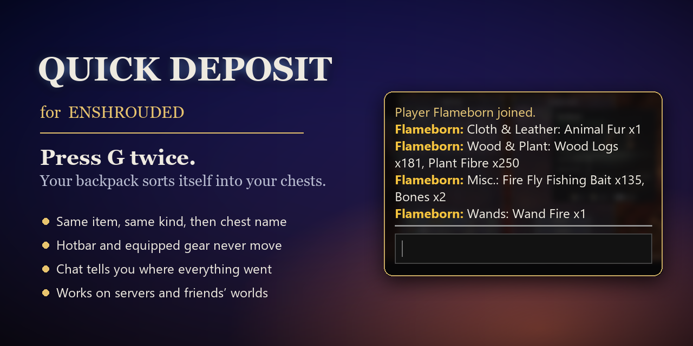
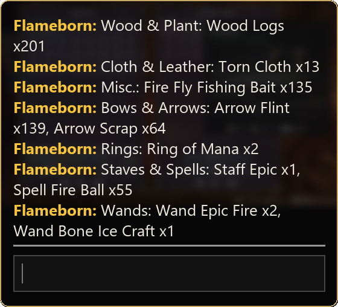
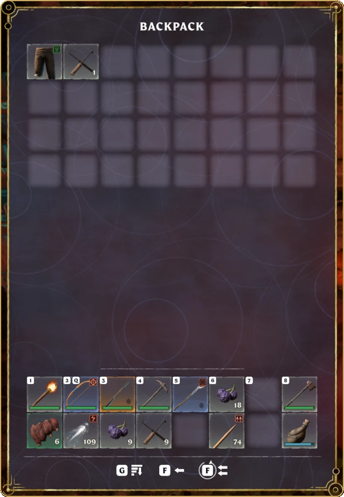

# Quick Deposit for Enshrouded

Open your inventory inside your base and press **G twice**. Everything in your backpack goes
into the chest where it belongs, and your chat tells you where it went. One G is still the
game's own Sort Inventory.

No mod loader, nothing to configure, works on dedicated servers and friends' worlds. Only you
need it installed.

## Where things go

1. **Same item** - every chest in the base gets the chest window's own "Deposit Stacks":
   stacks of items a chest already holds are topped up there.
2. **Everything else**, stack by stack, into a free slot of:
   1. a chest that holds the same item,
   2. else the chest holding the most items of the same kind (category; weapons: same weapon
      type; ammo: same ammo type or the weapons that fire it, e.g. arrows with bows;
      equipment: armor with armor, rings with rings),
   3. else the chest whose name matches the item ("Wands" for a wand, "Bows & Arrows" for
      arrows),
   4. else, for weapons, the chest holding the most weapons,
   5. else the chest nearest to you.

Your chat then shows where everything went, using your chest names ("Wands: Wand Epic Fire
x1"; unnamed chests are called after what they mostly hold), and `quick-deposit-report.txt`
in the game folder has the full report. Those chat lines exist only on your screen; nothing
is sent to other players.

Every move is a normal transfer that the host checks and performs, exactly as if you had
dragged the item yourself.

## What is never moved

- Your hotbar (both rows), equipped gear, cosmetics and currency.
- Categories left out of `tier2Categories` (default: none - everything in the backpack grid
  is sorted; your hotbar is what you keep).
- Crafting stations: only storage chests are used.
- Chests whose name starts with `--` (rename one in game, e.g. "--My Stuff"), and chests
  listed in `excludeChests`: they get nothing, not even "Deposit Stacks" top-ups.

 

## Install

1. Close Enshrouded.
2. Download `QuickDeposit-1.1.1.zip` from [Releases](../../releases/latest) or
   [Nexus Mods](https://www.nexusmods.com/enshrouded/mods/195).
3. In Steam: right-click Enshrouded > Manage > Browse local files.
4. Copy `powrprof.dll` from the zip into that folder, next to `enshrouded.exe`.
5. Start the game.

Works next to EML, Shroudtopia and Auto Loot Plus. Uninstall: delete `powrprof.dll` (and
`quick-deposit.ini` / `.log` / `-report.txt` if you like).

## Settings (`quick-deposit.ini`)

Created on first start in the game folder; edit it while the game is closed.

| Key | Default | Meaning |
|---|---|---|
| `enabled` | `1` | `0` turns the mod off |
| `doubleSortMs` | `500` | how quickly the second G must follow; `0` turns double-G off |
| `hotkey` | (none) | optional extra key: `F1`-`F12` or a virtual-key code such as `0x76` |
| `delayMs` | `100` | pause between chests; raise it if chests get skipped on a laggy server |
| `settleMs` | `1500` | wait for the server's changes before the next step and the report |
| `tier2` | `on` | `on`, `dry` (only report the plan) or `off` (only "Deposit Stacks") |
| `excludeChests` | (none) | chest names to skip, comma-separated (besides names starting with `--`) |
| `tier2Categories` | `all` | what step 2 may move: `all` or a list such as `Materials,Weapons` |

## Limits

- Only inside a base (flame altar area); the host decides whether you may deposit there.
- The in-game "area deposit" toggle of a chest is not honored.
- Chat lines appear under your own name, and only after the first system message of the
  session has arrived (one comes right after you join).
- Built against game build 1269579 (release 1.0, October 2026). After a game update the mod
  may stay inactive and log `signature not found`; the game runs normally.
- Some antivirus programs distrust DLL mods in general. This one only adds the deposit and
  forwards everything else to Windows' own `powrprof.dll`; the source is all here.

## Build

`build.bat` with the VS 2022 Build Tools produces `bin\powrprof.dll`.
`tools\gen_proxy.py` regenerates the powrprof forwarders, and
`tools\sigtest.bat <enshrouded.exe>` checks all signatures against a game build offline.

## How it works

`powrprof.dll` is imported by `enshrouded.exe`, so a copy in the game folder loads first; all
exports forward to the system DLL. Everything runs on the client:

- `client.cpp` hooks the per-frame UI command loop and the UI dispatcher. A second Sort
  Inventory within `doubleSortMs` starts a small state machine: snapshot, "Deposit Stacks"
  per chest, wait, per-stack moves, wait, report. Commands go through the UI dispatcher as
  the chest window's own transfer command (0x2c).
- `inventory.cpp` reads inventories from the client's ECS registry (learned by hooking
  `ViewInit`), item data from the item database (learned by hooking the item lookup), finds
  every container of the base through the registry's entity table, tells storage chests from
  stations, finds the hotbar, and resolves chest names from the custom string store.
- `chat.cpp` hooks the chat log's append to learn this client's sender fields and posts the
  result lines into the local chat log.

## License

[MIT](LICENSE)
